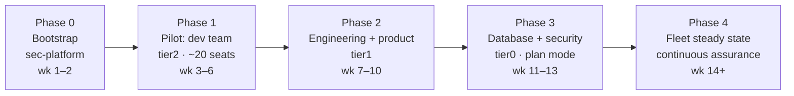

# Enterprise rollout plan

Five phases, five teams (dev, engineering, product, database, security), one rule: **a phase does not start until the previous phase's exit gate is green.** No exceptions for enthusiasm; guardrail gaps found late cost 10x.

## Phase 0 — Bootstrap (security team, weeks 1–2)

Enterprise org configured: SSO/SAML against the IdP, SCIM provisioning from the five team groups, domain capture on, roles per `policy/cohorts.yaml`. This repo live with branch rulesets (required checks + CODEOWNERS). Evidence infra applied (`terraform/`), OTel collector and Grafana dashboards receiving. MDM deploy script staged against a test device group.

**Exit gate:** all CI checks green on a test PR · managed settings self-heal demonstrated on a wiped test Mac · a seeded fake secret and a fake personnummer both blocked live and visible in all applicable evidence streams · offboarding test: IdP group removal kills the seat.

## Phase 1 — Pilot: dev team, tier2 (~20 seats, weeks 3–6)

Lowest-risk cohort, sandboxes and internal tools. Goals: shake out false positives (every FP is a bug — fix the rule, add a must-not-block test), tune the ask-list friction, validate session-banner latency at fleet scale, write the internal onboarding one-pager.

**KPIs:** weekly active seats >70% · guardrail FP reports trending to zero · zero unmanaged sessions in telemetry · #claude-code-help response <1 business day.
**Exit gate:** two consecutive weeks with no new FP classes and no invariant incidents.

## Phase 2 — Engineering + product, tier1 (weeks 7–10)

Product services and APIs. `tier-stamp` opens PRs into mapped tier1 repos; AI security reviewer enabled on their PRs (comment-only); team leads run the golden path (`/security-review` before human review).

**KPIs:** tier profiles stamped and merged in 100% of mapped repos · secret-scan and dependency-review required on all tier1 repos · AI-review comment precision sampled monthly by sec-platform.
**Exit gate:** one full release cycle per team with guardrails on and no bypass requests escalated.

## Phase 3 — Database + security teams, tier0 (weeks 11–13)

Highest-sensitivity last, on a hardened profile: plan-mode default, DB access denied outright, auto-memory off. Database team works schema/migration repos with Claude Code proposing, pipelines applying.

**KPIs:** zero PII-filter blocks originating from tier0 repos (the data shouldn't be near a session at all) · 100% of tier0 sessions in plan-first mode per telemetry.
**Exit gate:** security review of 4 weeks of tier0 evidence finds no control gaps.

## Phase 4 — Steady state (week 14+)

- **Continuous assurance:** monthly adversarial re-test of hooks (red-team the block list), quarterly policy review, quarterly Console key rotation, scorecard trending.
- **Evidence reviews:** monthly Athena sampling of guardrail events; alert on any device with telemetry gaps >1 check-in interval.
- **Change management:** every policy change is a PR through the full gate set; emergency loosening has a named approver (head of security) and an expiry date.
- **Access reviews:** quarterly seat-to-IdP-group reconciliation.

## Ownership

| Area | Owner |
|------|-------|
| This repo, policy floor, hooks, admin console | security team (sec-platform) |
| Evidence infra, OTel/Grafana | platform engineering |
| MDM deployment | IT / endpoint |
| Tier mappings for their repos | each team lead, via PR reviewed by sec-platform |
