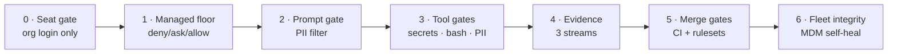

# Security guardrails — from scratch to end

Every guardrail in the platform, in the order a request meets them. For each: **what it blocks, what deterministically enforces it, the test that proves it, and the evidence it emits.** If a row has no enforcement mechanism, it isn't a guardrail — it's a wish, and it doesn't belong in this file.

The chain, end to end:

## 0 · Seat gate — before a session exists

| Guardrail | Blocks | Enforced by | Proven by | Evidence |
|---|---|---|---|---|
| Forced org login | personal accounts, API-key auth on laptops | `forceLoginMethod`+`forceLoginOrgUUID` in root-owned managed settings | `validate-settings.sh`, invariant tests | Enterprise audit logs |
| Seat lifecycle | orphaned access after offboarding | SCIM deprovision from IdP groups | IdP access review | admin console |
| Domain capture | corp-email consumer accounts | Enterprise admin console | console config review | admin console |

## 1 · Managed floor — before the model acts

| Guardrail | Blocks | Enforced by | Proven by | Evidence |
|---|---|---|---|---|
| Secret-material reads | `.env`, keys, `~/.aws`, `~/.ssh`, tfstate, credentials files | `deny` array in composed floor | validate assertion (`~/.aws` unreadable) | permission-denial telemetry |
| Exfil primitives | `WebFetch`, `curl`, `wget`, DNS games | `deny` array | validate assertion (WebFetch denied) | telemetry |
| Destructive ops | `terraform apply/destroy`, `cdk deploy`, `aws s3 rm/rb`, force-push, `npm publish`, `docker push`, `sudo` | `deny` array | composed artifact inspection | telemetry |
| Control-surface edits | `.claude/settings.json`, hooks, workflows, CODEOWNERS | `deny` array | composed artifact inspection | telemetry |
| Bypass mode | `--dangerously-skip-permissions` fleet-wide | `disableBypassPermissionsMode` forced from base by `compose.sh` | validate assertion + compose logic | composed artifact |
| One-way valve | any lower layer loosening the floor | union-only merge in `compose.sh`; managed layer wins at runtime | valve test: tier allow never pierces base deny | PR history |
| Sensitive-tier posture | auto-acting in tier0 repos | `defaultMode: plan` + DB denies in tier0 profile | tier0 compose output | telemetry |
| MCP sprawl | unvetted/mutated MCP servers | two-key rule: pinned `mcp-catalog.yaml` entry AND floor allowlist; `strictKnownMarketplaces` | catalog review on PR | catalog history |

## 2–3 · Runtime gates — as the model acts

| Guardrail | Blocks | Enforced by | Proven by | Evidence |
|---|---|---|---|---|
| Secrets gate | live credentials in Edit/Write/Bash payloads | `secrets-gate.sh` exit 2 — builtin regex always, gitleaks in union | 7 test cases (block + allow) | JSONL + HTTP event |
| Bash sentry | decode-exec, pipe-to-shell, home-dir destruction, persistence, history tampering | `bash-sentry.sh` exit 2 | 7 test cases | JSONL + HTTP event |
| PII filter | checksum-valid personnummer/hetu/IBAN/PAN in prompts and file writes | `pii-filter.py` exit 2 | 7 test cases incl. must-not-block lookalikes | JSONL + HTTP event |
| Hook integrity | users removing/replacing the hooks | `allowManagedHooksOnly` + `allowedHookUrls` + force-enabled plugin, all in the floor | validate assertion | composed artifact |
| False-positive discipline | guardrails that block legitimate work | every hook ships must-not-block tests; failures fail the PR | `tests/test_hooks.sh` (28 cases) | CI history |

## 4 · Evidence — always

Audit-before-block in every hook; JSONL hashes inputs and never stores payloads; OTel pinned from base env (tiers cannot repoint it); server-side Compliance API export runs off-laptop. Detail: [architecture/05](architecture/05-evidence-and-telemetry.md).

## 5 · Merge gates — before anything ships

| Guardrail | Blocks | Enforced by | Proven by | Evidence |
|---|---|---|---|---|
| Policy regression | any invariant regressing in a PR | `validate-settings.sh` in required check | its own assertions | CI history |
| Leaked secrets in git | credentials reaching main | `secret-scan` (gitleaks, full history), required | CI runs | CI + SARIF |
| Insecure evidence infra | public buckets, unencrypted storage | `iac-scan` (checkov+tfsec), required | CI runs | CI |
| Supply-chain drift | unpinned actions, risky dependency diffs | SHA-pin lint + `dependency-review`, required; invariant test mirrors the lint | lint + test case | CI |
| Unreviewed policy change | merges without sec-platform eyes | CODEOWNERS + branch ruleset (checks + review required) | ruleset config | PR history |
| AI overreach in CI | reviewer approving/merging | comment-only permissions; only Console API key it holds is spend-capped | workflow permissions block | PR comments |

## 6 · Fleet integrity — forever after

Checksum-verified, atomic, root-owned install; self-healing on every MDM check-in; drift bounded by sync interval and visible as a telemetry gap. Detail: [architecture/06](architecture/06-distribution-mdm.md).

## What is deliberately NOT a guardrail

- **CLAUDE.md and prompts** — advisory context. They improve behavior; they enforce nothing.
- **The AI security reviewer** — advisory breadth on every PR; merge decisions belong to deterministic checks and humans.
- **Free-text PII detection** — out of scope for blocking (unbounded false positives); handled by training + review, honestly documented in the threat model's residual risks.
