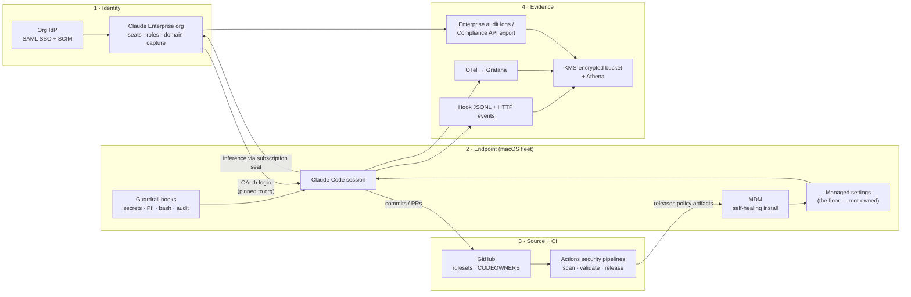

# 00 — Platform overview

One sentence: **every Claude Code session at ABC runs on an Enterprise seat, under a managed policy floor it cannot loosen, behind hooks that block bad actions before they execute, and everything it does leaves evidence in three independent streams.**

Prompts and CLAUDE.md are guidance. The only things that count as controls are: managed settings, exit-2 hooks, GitHub rulesets, and the Enterprise admin console. If a control can be talked out of enforcing, it is not a control.

## Layers and what enforces them

| # | Layer | Doc | Deterministic enforcement |
|---|-------|-----|---------------------------|
| 1 | Identity & seats | [01](01-identity-and-seats.md) | SSO/SCIM, domain capture, `forceLoginMethod` + `forceLoginOrgUUID` |
| 2 | Policy floor | [02](02-policy-layer.md) | Root-owned managed settings; one-way-valve compose in CI |
| 3 | Runtime guardrails | [03](03-runtime-guardrails.md) | Exit-2 PreToolUse hooks, managed-hooks-only |
| 4 | CI/CD security pipeline | [04](04-cicd-security-pipeline.md) | Required checks, SHA-pinned actions, CODEOWNERS |
| 5 | Evidence & telemetry | [05](05-evidence-and-telemetry.md) | Three independent streams; hooks audit before they block |
| 6 | Distribution (MDM) | [06](06-distribution-mdm.md) | Checksum-verified atomic install, root:wheel, self-healing |
| 7 | Threat model | [07](07-threat-model.md) | The map of who is stopped where |

## The five invariants

1. **Deterministic enforcement only.** Security lives in managed settings, hooks, rulesets, and the admin console — never in prompts.
2. **One-way valve.** Project and user layers can only narrow the managed floor. An allow can never pierce a managed deny.
3. **No static credentials on laptops.** Humans authenticate with their Enterprise seat via claude.ai OAuth. The only API key in the platform lives in CI secrets.
4. **Everything emits evidence.** Three independent streams; losing one still leaves two.
5. **Bypass permissions mode is disabled fleet-wide.** No exceptions on endpoints.

## What breaks if you skip this platform

A developer with an unmanaged Claude Code install and a personal account: no floor, no hooks, no telemetry, secrets and customer data one paste away from a consumer account, and zero evidence any of it happened. Every layer below exists to make that state impossible, not discouraged.
