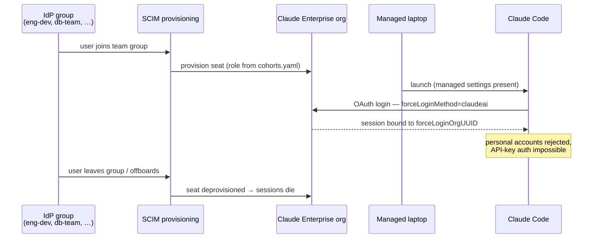

# 01 — Identity & seats

Blunt version: **nobody uses Claude Code at ABC on a personal account, and no laptop ever holds an API key.** Identity flows from the org IdP into the Claude Enterprise org via SAML SSO and SCIM; managed settings pin every session to that org; offboarding in the IdP kills the seat.

## Controls at this layer

| Control | Mechanism | Where |
|---------|-----------|-------|
| Only org seats can log in | `forceLoginMethod: "claudeai"` + `forceLoginOrgUUID` | `policy/base.json` (managed, root-owned) |
| Seats mirror team membership | SCIM from IdP groups → cohort roles | `policy/cohorts.yaml` documents the mapping |
| Personal-account capture | Enterprise domain capture on `@abc-org.example` | Admin console |
| No API keys on laptops | No `apiKeyHelper`, no `ANTHROPIC_API_KEY` in any managed env; CI asserts it | `ci/validate-settings.sh`, `tests/test_hooks.sh` |
| Offboarding | IdP group removal → SCIM deprovision → seat revoked | IdP + admin console |

## Cohorts

Five teams, three tiers (`policy/cohorts.yaml`): **dev** → tier2, **engineering** and **product** → tier1, **database** and **security** → tier0. A person in two cohorts gets the most restrictive tier.

## What breaks if this layer is bypassed

A personal claude.ai login means org data flows through an account ABC cannot audit, retain, or revoke. `forceLoginOrgUUID` in root-owned managed settings is the deterministic stop; domain capture is the backstop for accounts created with corp email.
