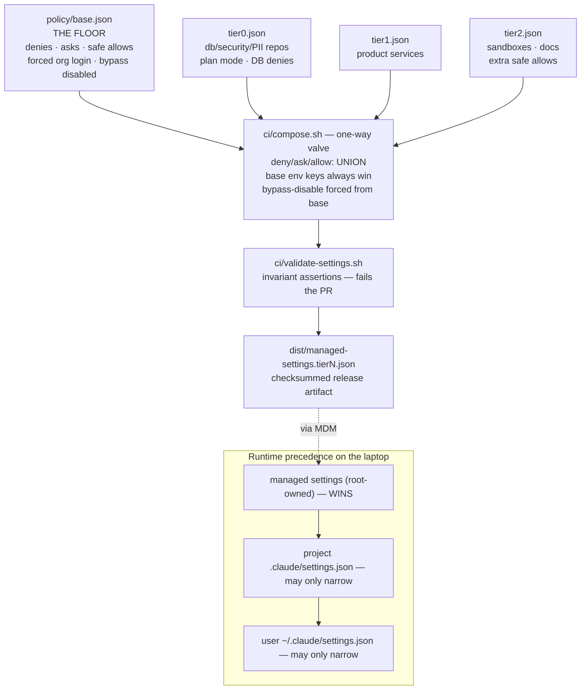

# 02 — Policy layer (the floor and the one-way valve)

Blunt version: **there is one base floor, three tier profiles, and a merge rule that only ever adds restriction.** `ci/compose.sh` is the only path from policy source to a deployable artifact, and `ci/validate-settings.sh` fails the PR if any invariant regresses.

## Merge semantics (the valve)

| Field | Rule | Why |
|-------|------|-----|
| `deny` / `ask` / `allow` | union of base + tier | a tier can add restriction or add safe allows; it can never remove a base deny — deny wins at runtime anyway |
| `env` | tier may add keys, base keys always win | no tier can repoint telemetry or unset the forced login |
| `defaultMode` | tier may override (tier0 → `plan`) | mode is posture, not a security boundary |
| `disableBypassPermissionsMode` | forced from base, always | the one field no layer may ever touch |

## Invariants validate-settings.sh enforces on every PR

Valid JSON · bypass disabled · managed-hooks-only · login pinned to the org (`forceLoginMethod`/`forceLoginOrgUUID`) · no `apiKeyHelper`, no `ANTHROPIC_API_KEY` · `WebFetch` denied · `~/.aws` unreadable · no rule in both allow and deny.

## What breaks if this layer is bypassed

Nothing on the endpoint reads `policy/` — laptops only ever see the composed, validated, checksummed artifact. Editing policy source without passing CI produces nothing deployable; editing the deployed file on a laptop is reverted by MDM self-healing ([06](06-distribution-mdm.md)).
