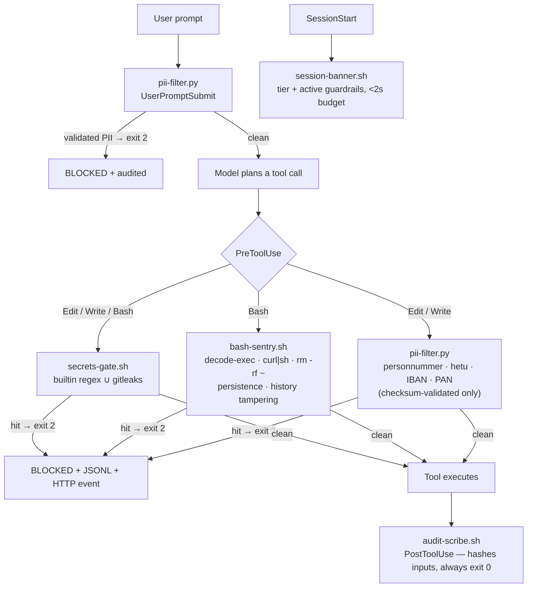

# 03 — Runtime guardrails (hooks)

Blunt version: **five hooks sit between the model and the machine.** Anything matching a live credential, validated PII, or a hostile shell pattern is blocked with exit 2 *before it executes*, and the block itself is audited first. False positives are treated as bugs — a guardrail that blocks legitimate work trains people to route around it.

## The five hooks

| Hook | Event | Blocks | Deliberately allows |
|------|-------|--------|---------------------|
| `secrets-gate.sh` | PreToolUse (Edit/Write/Bash) | AWS keys, GitHub PATs, Slack tokens, private-key blocks, `sk-ant-*` — builtin regex always runs, gitleaks adds breadth | ARN/name references, prose about key formats |
| `bash-sentry.sh` | PreToolUse (Bash) | base64-decode-exec, curl/wget→shell, `rm -rf` on `/`/`~`, LaunchAgents/crontab persistence, history clearing, chmod 77x | `rm -rf node_modules`, normal test/build commands |
| `pii-filter.py` | UserPromptSubmit + Edit/Write | **checksum-validated** Swedish personnummer (Luhn), Finnish hetu (mod-31), IBAN, card PANs (Luhn) | phone numbers, invalid-checksum lookalikes — honesty about scope: structured identifiers only, not free-text PII |
| `audit-scribe.sh` | PostToolUse | nothing — evidence only; hashes tool inputs, never stores payloads | — |
| `session-banner.sh` | SessionStart | nothing — injects tier + guardrail context; <2s CI-enforced budget | — |

## Why hooks can't be removed client-side

`allowManagedHooksOnly: true` and `allowedHookUrls` live in the root-owned managed settings ([02](02-policy-layer.md)); the plugin is force-enabled from the floor. A user or project hook can add checks, never subtract these.

## What breaks if this layer is bypassed

The permission floor still denies the worst categories (secret reads, sudo, curl), but pattern-level protection — a PAN inside a fixture, a `curl|sh` inside an allowed script — is gone, and so are two evidence streams. Every block case and every must-not-block case is pinned by `tests/test_hooks.sh` (28 cases, run on every PR).
