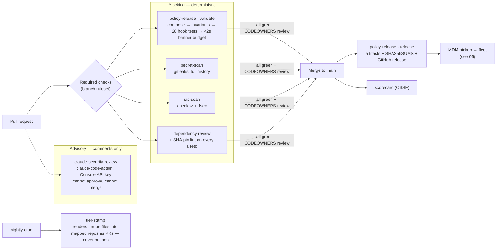

# 04 — CI/CD security pipeline

Blunt version: **deterministic scanners gate the merge; the AI reviewer only comments.** Seven workflows, every action pinned to a 40-char SHA, and the only static API key in the entire platform lives here — a spend-capped Console workspace key in a GitHub secret.

## The workflows

| Workflow | Trigger | Role | Blocking? |
|----------|---------|------|-----------|
| `policy-release` | PR on policy/ci/plugins/tests; push to main | compose → validate invariants → hook tests → latency budget; on main: checksummed release | **Yes** |
| `secret-scan` | every PR + main | gitleaks over full history, same config the endpoint hook extends | **Yes** |
| `iac-scan` | PR touching terraform/ | checkov + tfsec, fail on high | **Yes** |
| `dependency-review` | every PR | dependency diff + lint failing any non-SHA-pinned action | **Yes** |
| `claude-security-review` | every PR | AI review via `/security-review` skill → 4 read-only agents | No — comment-only |
| `tier-stamp` | nightly cron | opens PRs stamping tier profiles into mapped repos (`policy/repos.yaml`) | n/a |
| `scorecard` | weekly + main | OSSF Scorecard on this repo itself | No |

## CI credential rules

- The AI reviewer authenticates with `secrets.ANTHROPIC_API_KEY`: a dedicated Console workspace key — spend-capped, quarterly-rotated, never a human seat credential.
- `tier-stamp` needs a fine-grained org token (`TIER_STAMP_TOKEN`); absent, it dry-runs.
- Everything else uses the ephemeral `github.token`. No long-lived cloud credentials anywhere in CI.

## What breaks if this layer is bypassed

Branch rulesets are the enforcement, not the workflows: if required checks + CODEOWNERS aren't configured on `main`, a direct push skips every gate above. The repo ships the checks; the ruleset makes them mandatory — configure both.
