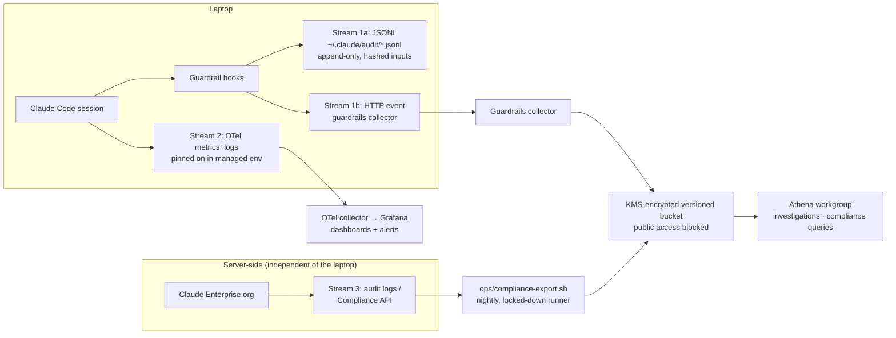

# 05 — Evidence & telemetry

Blunt version: **three independent evidence streams, so no single failure — or single tamperer — leaves you blind.** Hooks audit *before* they block; telemetry is pinned on from the managed floor; the Enterprise org keeps its own record server-side. All three land in one KMS-encrypted, versioned bucket, queryable in Athena.

## The three streams

| Stream | Source | Survives | Provisioned by |
|--------|--------|----------|----------------|
| 1. Hook audit (JSONL + HTTP) | `audit-scribe.sh` + block events from every guardrail | laptop-local tampering only partially — which is why the HTTP copy fires in the same breath, before the block returns | plugin (endpoint), collector (external) |
| 2. OTel → Grafana | managed env: `CLAUDE_CODE_ENABLE_TELEMETRY=1`, OTLP endpoint — base env keys can't be overridden by any tier | hook removal — telemetry is emitted by Claude Code itself | OTel collector (external) |
| 3. Enterprise audit / Compliance API | the org's server-side record of seat usage | **anything done to the laptop** — the user cannot touch this stream | `ops/compliance-export.sh` → bucket (`terraform/audit_evidence.tf`) |

## Evidence-sink infra (all the Terraform this platform needs)

`terraform/audit_evidence.tf`: KMS key with rotation, versioned S3 bucket with SSE-KMS and full public-access block, Athena workgroup with encrypted results. Nothing else — identity and inference are the Enterprise plan's job.

## What breaks if this layer is bypassed

Blocks still block, but incidents become unreconstructable and compliance attestations become vibes. Design rule that keeps this honest: **hooks write evidence first, block second** — a session killed mid-block has already left its record.
