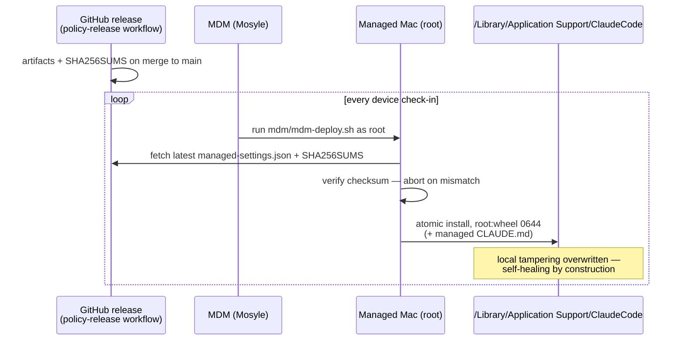

# 06 — Distribution (MDM)

Blunt version: **policy reaches laptops as a checksum-verified, root-owned file that heals itself on every MDM check-in.** Users can't edit it, and deleting it buys minutes, not freedom.

## Controls at this layer

| Control | Mechanism |
|---------|-----------|
| Integrity | SHA256 verified against the release manifest before install; mismatch = no install |
| Immutability to users | root:wheel 0644 in a system path — admin rights required to touch it |
| Atomicity | `install` to temp + rename; never a half-written policy file |
| Self-healing | re-installed on every check-in; drift lifetime = one MDM sync interval |
| Provenance | artifact traceable to a `main` commit that passed validate + tests + CODEOWNERS review |

## What breaks if this layer is bypassed

A user with admin rights who deletes the file gets an unmanaged session until the next check-in — but stream 3 evidence ([05](05-evidence-and-telemetry.md)) still records their seat usage server-side, and fleet telemetry going dark for one device is itself an alertable signal. Residual risk is bounded by check-in frequency; set it accordingly.
