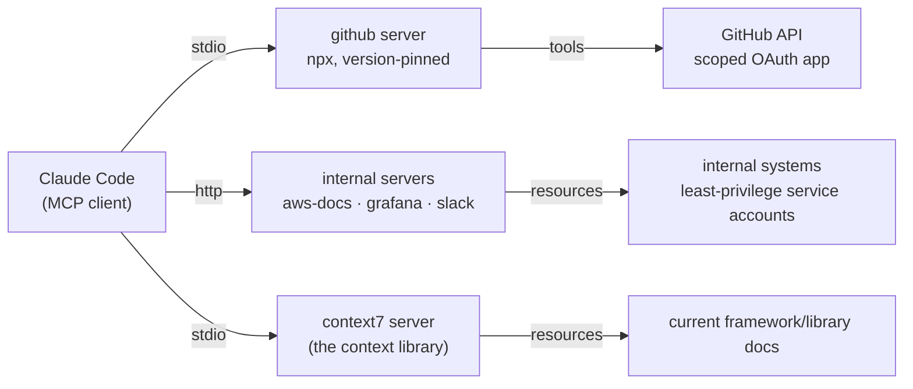
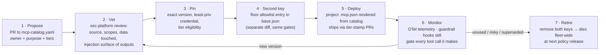

# 08 — MCP: what it is, why it matters, and its lifecycle

Blunt version: **MCP (Model Context Protocol) is how Claude Code reaches beyond the repo — and every server you add is capability AND attack surface in equal measure.** So ABC treats MCP servers like production dependencies: vetted once, pinned exactly, allowed twice (the two-key rule), monitored always, retired deliberately.

## What MCP is

An open, vendor-neutral protocol that connects an AI client (Claude Code) to external systems through servers that expose three things:

| Primitive | What it gives the model | Example |
|-----------|------------------------|---------|
| **Tools** | actions it can invoke | create a GitHub issue, query Grafana |
| **Resources** | data it can read | a dashboard, a runbook, a schema |
| **Prompts** | reusable task templates | "triage this alert" |

Claude Code is the MCP *client*; servers run as local processes (`stdio`) or remote endpoints (`http`/`sse`). Think "USB-C for AI context": one protocol, many integrations, no bespoke glue per tool.



## Why it matters

- **Capability:** without MCP, Claude Code knows your repo and its training data. With it, it can read your dashboards, file your issues, and pull current library docs instead of hallucinating a 2024 API.
- **Risk, in the same breath:** an MCP server is code that runs with tool outputs flowing straight into the model's context. A malicious or compromised server is simultaneously a supply-chain vector (it executes), a prompt-injection vector (its outputs can steer the model), and a data-exfiltration vector (its credentials define the blast radius). This is exactly the threat-model row 9 in [07-threat-model.md](07-threat-model.md).

## The context library — the approved catalog

`policy/mcp-catalog.yaml` is ABC's context library: the **only** MCP servers a session may use. Every entry carries an exact version pin, tier eligibility, and a least-privilege credential note. Notable entries:

| Server | Purpose | Tiers | Credential stance |
|--------|---------|-------|-------------------|
| `github` | issues/PRs from the session | 0,1,2 | per-user OAuth, no admin scopes |
| `aws-docs` | AWS reference lookup | 0,1,2 | none — read-only docs |
| `grafana` | dashboards/metrics context | 1,2 | viewer account, PII datasources excluded |
| `slack` | notifications | 1,2 | bot token, #eng-* only |
| `context7` | **up-to-date library/framework docs pulled into context on demand** — kills the "model trained on last year's API" class of bugs | 1,2 | none — public docs, read-only |

**The two-key rule:** a server works only when it exists in the catalog **and** the managed floor permits it (`strictKnownMarketplaces` / allowlist in `policy/base.json`). One PR can't grant both keys past CODEOWNERS — adding capability always crosses a sec-platform review.

## Lifecycle — from proposal to retirement



Rules that make the lifecycle real rather than ceremonial:

1. **No floating versions.** `@latest` is how a supply-chain compromise ships itself; upgrades re-enter at step 2.
2. **Credentials are scoped to the server's purpose,** never a person's. A docs server gets nothing; Slack gets one channel family.
3. **Hooks still apply.** An MCP tool call goes through the same PreToolUse gates as everything else — the catalog grants reach, not exemption.
4. **Retirement is a deletion, not a memo.** Removing the catalog entry and the allowlist entry kills the server everywhere at the next policy release.

## How to use it (developer view)

```bash
# See what's approved for your repo's tier
cat policy/mcp-catalog.yaml

# Project scope (preferred — reviewed like code, shared with the team):
# .mcp.json at the repo root, rendered from the catalog entry, e.g.:
{
  "mcpServers": {
    "context7": {
      "command": "npx",
      "args": ["-y", "@upstash/context7-mcp@1.0.14"]
    }
  }
}

# Then, in a session, just ask — e.g.
#   "use context7: current Next.js 15 app-router data fetching APIs"
# and cite-current docs land in context instead of trained guesses.

# Check what's live in your session
claude mcp list
```

Want a server that isn't in the catalog? PR the catalog entry (step 1) — never `claude mcp add` something unvetted; the floor will refuse it, and that refusal is working as designed.

## What breaks if this layer is bypassed

An unvetted MCP server is an unreviewed binary with a straw into your model's context and possibly your credentials. The two-key rule plus `allowManagedHooksOnly` means bypassing this layer requires defeating the managed floor itself ([02](02-policy-layer.md)) — which is the point.
